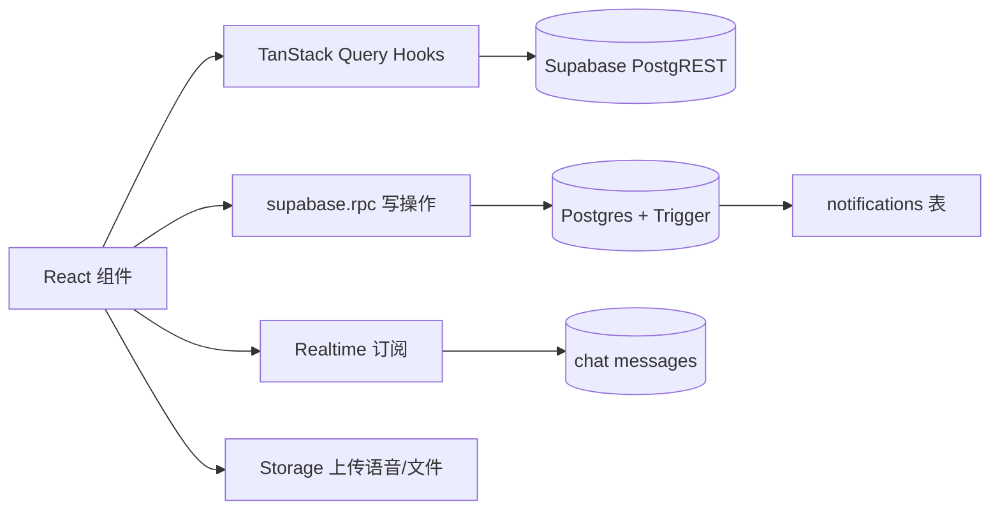

## 产品概述

将现有 TimePin（本地 Dexie PWA）改造为基于 Supabase 的多人协作「任务系统 + 即时通讯」Web 应用。后端（Postgres + Auth + Realtime + Storage）已配置完成，人员与任务数据已录入。前端技术栈：React 18 + Vite + TypeScript + TailwindCSS + React Router + TanStack Query + Supabase JS Client。

## 核心需求

### 一、基础架构与登录

- 清理 TimePin 本地数据库逻辑（Dexie / IndexedDB）与无用依赖（recharts 等），保留 Tailwind 中 brand 红色等 UI 配置。
- 根目录 `.env.local` 提供 `VITE_SUPABASE_URL` 与 `VITE_SUPABASE_ANON_KEY`；新建 `src/lib/supabase.ts`。
- 登录页（`src/pages/Login.tsx`）：展示预置人员名单 → 点击名字 → 弹窗输入 6 位 PIN → 前端把名字转成假邮箱（Eric Li → eric.li@ufc.internal）连同 PIN 调用 `supabase.auth.signInWithPassword` → 跳转主界面。
- 路由守卫：未登录强制跳 `/login`。

### 二、权限与用户模型（4 级）

- L0_super（代码级，不通过 UI）、L1_admin（全局）、L2_leader（本组任务操作+可看全部）、L3_member（只操作自己任务、只看本组）。所有用户归属 `group_id`。

### 三、任务系统（Task）

- 数据表：`tasks`、`task_claimants`、`reactions`。
- `src/lib/deriveColor.ts`：红=仅我认领；蓝=我认领且>1 人；绿=本组他人认领；灰=无关。
- 任务墙：默认展示未完成 + 已完成且在 5 天窗口内（`completed_at > now-5d`）；卡片含色条/标题/种类/认领者头像(带时间状态+天赋贴纸)/截止日期；排序 红>蓝>绿>灰，同色按截止升序。
- 操作：L1 建任务(全员可认领)/L2 建任务(仅本组)；认领写入 `task_claimants`；完成/延期仅认领者或 L1 可点，调用 RPC；转发任务卡片到聊天；已完成卡片底部 emoji 反应。
- 通知页：未读/已读；认领/完成/延期触发通知（RPC 或 Trigger）。

### 四、即时通讯（Chat）

- Supabase Realtime + Storage。会话：总群(全员)/管理员群(L1+L2)/小组群(group_id)/私聊(按权限：L3 仅同组、L2 本组+其他组长+管理员、L1 所有人)。
- 消息：文字/Emoji、语音(≤30s 前端限制)、文件(≤1MB 走 Storage 拿 URL)。

### 五、布局与路由

- 经典后台布局：左侧边栏(任务墙/聊天/通知/管理面板/个人设置) + 顶部栏(当前用户) + 主内容区。
- 路由：`/login`、`/`、`/chat`、`/notifications`、`/admin`(仅 L1)、`/settings`(time_status、talents)。

### 六、计划交付要求

- 扫描并列出删除的 TimePin 旧文件与新文件树。
- 分阶段（M0 基建 / M1 清理 / M2 登录路由 / M3 任务墙权限 / M4 聊天 / M5 管理面板细节）。
- 明确哪些功能依赖 RPC、哪些前端直查，并给出 React Query 封装思路。

## 技术栈

- 框架：React 18 + Vite + TypeScript
- 样式：TailwindCSS（保留 `tailwind.config.js` 中的 brand 红色等 design tokens）
- 路由：React Router v6
- 服务端状态：TanStack Query（读表 + 缓存 + 失效）
- 后端客户端：@supabase/supabase-js（Auth / PostgREST / Realtime / Storage）
- 移除依赖：dexie、dexie-react-hooks、recharts、zustand（数据态改 React Query + Context，UI 态用轻量 Context）、vite-plugin-pwa
- 新增依赖：@supabase/supabase-js、@tanstack/react-query

## 实现策略

1. **清理优先**：删除 Dexie 相关（`src/db/*`、`useAppStore`、`useTasks`、`useNotifications`、`useOnboardingGate`、`usePwa` 及 vite-plugin-pwa），避免旧本地存储与 Supabase 双源冲突。
2. **Supabase 客户端单例**：`src/lib/supabase.ts` 导出 `supabase`，从 `import.meta.env` 读取 `.env.local`。
3. **认证与 RBAC**：`AuthContext` 持有当前用户 + profile（role/group_id）；`src/lib/rbac.ts` 提供 `can(action, ctx)` 判定；路由守卫包一层 `RequireAuth` 与 `RequireRole('L1')`。
4. **颜色派生纯函数**：`deriveColor(task, claimants, me, myGroup)` 不依赖网络，渲染期计算；任务墙排序据此分组。
5. **数据交互分层**：

- 前端直查（React Query `useQuery`）：任务墙列表（join `task_claimants` + `reactions` + claimant profiles）、通知列表、聊天历史。包装为 `src/hooks/queries/*`，统一 `staleTime`、错误重试、列表键。
- 写操作（RPC）：认领/完成/延期调用 `supabase.rpc(...)`；通知由 DB Trigger 在状态变更时写入 `notifications` 表（前端订阅）。
- 聊天实时：`supabase.channel(...).on('postgres_changes', ...)` 订阅 messages 插入；语音/文件走 `supabase.storage.from('chat').upload()`。

6. **性能**：任务墙一次查询带嵌套 claimants/reactions，避免 N+1；React Query 缓存 + 完成/认领后 `invalidateQueries`；聊天用 Realtime 增量更新而非轮询。

## 关键代码结构（接口级）

```ts
// src/lib/supabase.ts
export const supabase = createClient(
  import.meta.env.VITE_SUPABASE_URL,
  import.meta.env.VITE_SUPABASE_ANON_KEY
);

// src/lib/deriveColor.ts
export type TaskColor = 'red' | 'blue' | 'green' | 'gray';
export function deriveColor(params: {
  claimantIds: string[];
  meId: string;
  claimantGroupIds: string[];
  myGroupId: string;
}): TaskColor;

// src/lib/rbac.ts
export type Role = 'L0_super' | 'L1_admin' | 'L2_leader' | 'L3_member';
export function canComplete(task: Task, me: Profile): boolean; // 认领者 || L1
export function canCreateFor(groupScope: string | null, me: Profile): boolean;

// src/context/AuthContext.tsx
export interface AuthState { user: User|null; profile: Profile|null; loading: boolean; }
```

## 架构数据流（mermaid）



## 后端依赖假设（需确认/补建）

- 已存在：`tasks`、`task_claimants`、`reactions`、`profiles`(含 role/group_id/time_status/talents/display_name)、`notifications`。
- RPC 待确认是否存在：`claim_task`、`complete_task`、`delay_task`（默认 +3 天）；缺失则在 M3 开头补建 SQL。
- 聊天相关：`conversations`、`conversation_members`、`messages` 及 Storage bucket `chat`；缺失则在 M4 开头补建。
- 登录前提：Supabase Auth 已存在用户，email 为 `name@ufc.internal` 形式、密码为 6 位 PIN。

## 目录结构（新建 / 删除）

### 删除（TimePin 遗留）

- `src/db/index.ts`、`src/db/models.ts`
- `src/store/useAppStore.ts`
- `src/hooks/useOnboardingGate.ts`、`src/hooks/usePwa.ts`、`src/hooks/useTasks.ts`、`src/hooks/useNotifications.ts`、`src/hooks/useSwipe.ts`、`src/hooks/layoutContext.ts`
- `src/pages/Board.tsx`、`Calendar.tsx`、`Onboarding.tsx`、`Today.tsx`
- `src/components/calendar/*`、`src/components/task/*`、`src/components/settings/*`（重写为新需求）
- `src/components/layout/*`（重写为侧边栏+顶栏）
- `src/utils/*`（backup/board/calendar/calendarViews/lunar/notify/questionnaire/sorting/urgency/taskForm/i18n*/dictionaries* 全部删除）
- `vite.config.ts` 移除 vite-plugin-pwa；`package.json` 移除 dexie/dexie-react-hooks/recharts/zustand/vite-plugin-pwa

### 新建

```
.env.local                         # [NEW] Supabase URL + anon key（精确两行）
src/lib/supabase.ts                # [NEW] 客户端单例
src/lib/deriveColor.ts             # [NEW] 4 色派生纯函数
src/lib/rbac.ts                    # [NEW] 角色权限判定
src/lib/emailMapping.ts            # [NEW] 名字→假邮箱映射
src/lib/storage.ts                 # [NEW] 聊天文件/语音上传封装
src/types/database.ts              # [NEW] Supabase 表类型
src/context/AuthContext.tsx        # [NEW] 当前用户+profile+登录态
src/hooks/queries/useTasks.ts      # [NEW] 任务墙 React Query
src/hooks/queries/useNotifications.ts
src/hooks/queries/useChat.ts       # [NEW] 会话/消息 + Realtime
src/router/index.tsx               # [NEW] 路由+守卫
src/pages/Login.tsx                # [NEW] 名单+PIN 登录
src/pages/TaskWall.tsx             # [NEW] 任务墙（替代 Board/Today）
src/pages/Chat.tsx                 # [NEW] 即时通讯
src/pages/Notifications.tsx        # [NEW] 通知收件箱
src/pages/Admin.tsx                # [NEW] 管理面板（仅 L1）
src/pages/Settings.tsx             # [NEW] 个人设置（time_status/talents）
src/components/layout/AppLayout.tsx# [NEW] 侧边栏+顶栏+主区
src/components/layout/Sidebar.tsx
src/components/layout/Topbar.tsx
src/components/task/TaskCard.tsx    # [NEW] 卡片(色条/头像/截止)
src/components/task/TaskCreateModal.tsx
src/components/task/ReactionBar.tsx
src/components/chat/ConversationList.tsx
src/components/chat/ChatWindow.tsx
src/components/chat/MessageInput.tsx  # [NEW] 文字/语音/文件
src/components/chat/MessageBubble.tsx
src/components/ui/*                # [保留] 复用现有通用 UI 原语
```

## 设计风格

经典后台（Admin Dashboard）布局，沿用项目既有 Tailwind design tokens（brand 红 `#E5484D` 为主色），保持 TimePin 已有的圆角卡片、柔和阴影与留白节奏，不引入与品牌冲突的新视觉语言。整体克制、信息密度高、扫视效率优先——契合「任务墙一眼识别自己活」的核心目标。

## 布局

- **左侧边栏**：固定宽度，纵向排列 5 个导航项（任务墙 / 聊天 / 通知 / 管理面板 / 个人设置），当前项以 brand 红高亮；管理面板仅 L1 可见。
- **顶部栏**：右侧展示当前用户头像 + 名字 + 时间状态徽标 + 天赋贴纸，左侧显示当前页面标题。
- **主内容区**：右侧自适应；任务墙为响应式卡片网格，聊天为「左会话列表 + 右窗口」两栏。

## 任务卡片

自上而下：左侧 6px 色条（红/蓝/绿/灰）→ 标题 + 种类标签 → 认领者头像行（头像旁叠放时间状态色点 + 天赋贴纸 emoji）→ 截止日期（逾期标红）→ 底部操作区（认领/完成/延期/转发）+ 已完成时的 emoji 反应条。hover 微抬升阴影。

## 交互

- 按钮级可见性：非认领者/非 L1 看不到「完成/延期」；非 L1/L2 看不到「管理面板」。
- 颜色为实时派生，同一任务在不同用户眼中色条不同（红/蓝/绿/灰）。
- 聊天消息发送后 Realtime 即时出现，无刷新。